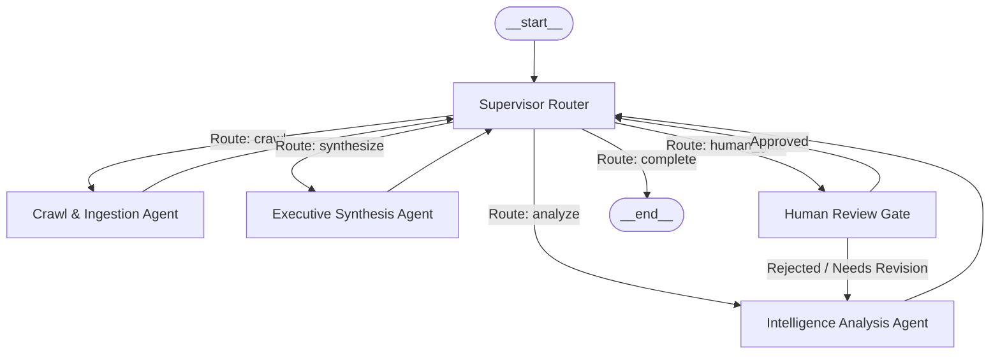

# Skill: Agent Graph Design & Orchestration

## 1. Overview
This skill guides the construction of robust, observable, and resilient state machines in LangGraph for competitor intelligence extraction, synthesis, and review.

---

## 2. Standard State Graph Topology



---

## 3. Implementation Workflow

### Step 1: Define Immutable State Schema
Always declare state using `TypedDict` or Pydantic with annotated reducers:
```python
from typing import Annotated, TypedDict
import operator

class CompetitorState(TypedDict):
    competitor_id: str
    target_urls: list[str]
    raw_crawls: Annotated[list[dict], operator.add]
    extracted_signals: Annotated[list[dict], operator.add]
    synthesis_report: dict | None
    next_step: str
    is_approved: bool
```

### Step 2: Implement Isolated Worker Nodes
Every worker node must:
1. Accept the state dictionary.
2. Call the `LLMFactory` (never call raw vendor clients directly).
3. Handle potential validation errors gracefully.
4. Return a partial state dictionary (the delta).

### Step 3: Implement the Supervisor Node
The supervisor acts as the central router:
- Evaluates the current state.
- Decides whether additional data gathering, analysis, human approval, or completion is required.
- Emits `{ "next_step": "..." }`.

### Step 4: Configure Checkpointing
- In local unit tests: Use `MemorySaver()`.
- In production/staging: Connect `RedisSaver` or `PostgresSaver` with session/thread IDs mapped to the competitor tracking run.

### Step 5: Verification Checklist
- [ ] No circular edges without an explicit termination condition.
- [ ] State mutations return new delta dictionaries.
- [ ] LLM calls use `BaseLLMProvider` via `LLMFactory`.
- [ ] LangSmith tags (`workflow_name`, `competitor_id`) are injected via `RunnableConfig`.
