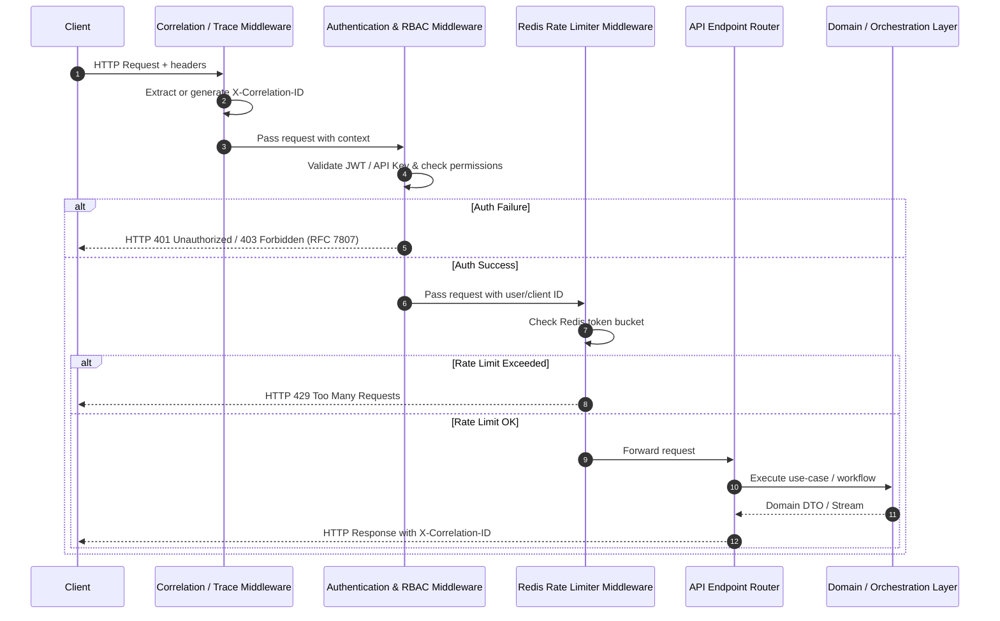

# API Lifecycle, Authentication & Error Handling

## 1. Authentication & RBAC Model
The FastAPI presentation layer enforces strict authentication and role-based access control (RBAC).

### Authentication Schemes
1. **Machine-to-Machine (Service)**: Handled via `X-API-Key` headers validated against hashed storage.
2. **User / Operator Sessions**: Handled via `Authorization: Bearer <JWT>` tokens containing user identity and role scopes.

### Role Matrix
| Role | Capabilities |
| :--- | :--- |
| `reader` | Query competitor profiles, view historical reports, stream public agent progress. |
| `analyst` | Trigger on-demand crawls, launch analysis workflows, run offline evaluations. |
| `admin` | Approve/reject Human-in-the-Loop review gates, update competitor registry, configure LLM provider keys. |

---

## 2. Request Lifecycle & Middleware Pipeline



---

## 3. Error Handling & RFC 7807 Problem Details
All API errors must return standardized JSON adhering to **RFC 7807 (Problem Details for HTTP APIs)**:

```json
{
  "type": "https://api.competitor-intel.internal/errors/resource-not-found",
  "title": "Competitor Not Found",
  "status": 404,
  "detail": "Competitor with ID 'acme-corp' does not exist in registry.",
  "instance": "/api/v1/competitors/acme-corp",
  "correlation_id": "c73a8184-e429-45be-bb37-9759c914bf6f"
}
```

### Standard Status Code Mapping
- `400 Bad Request`: Input schema validation failure or unparseable payload.
- `401 Unauthorized`: Missing or invalid credentials.
- `403 Forbidden`: Authenticated user lacks required RBAC role.
- `404 Not Found`: Target entity or report not found.
- `422 Unprocessable Entity`: Semantic domain validation error.
- `429 Too Many Requests`: Client exceeded rate limits.
- `502 Bad Gateway`: Downstream vendor (Groq, Tavily) outage.
- `500 Internal Server Error`: Unhandled server exception (masked details).
