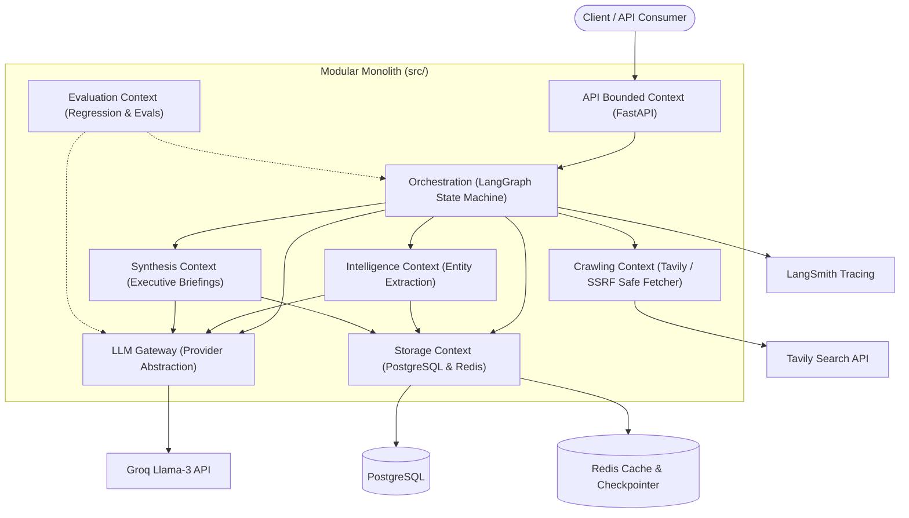
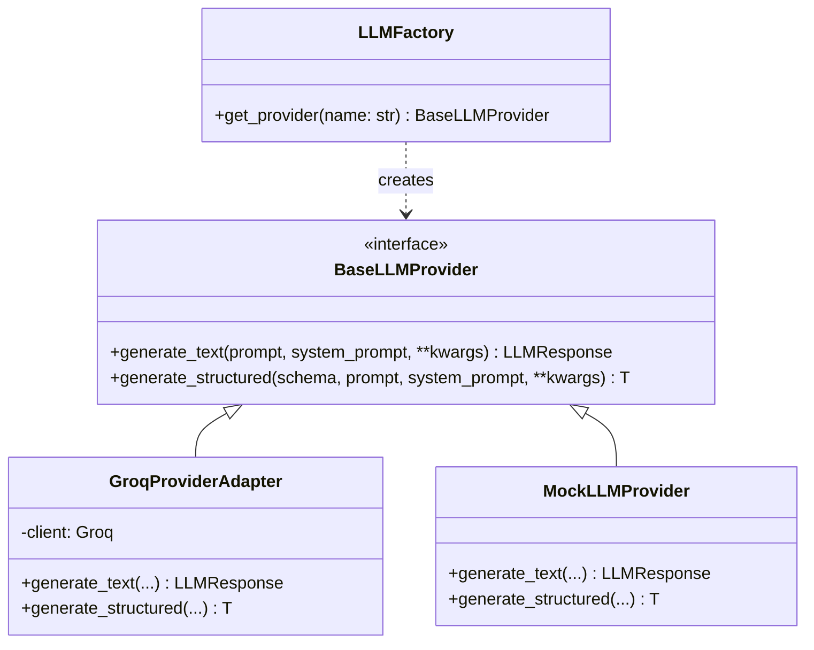
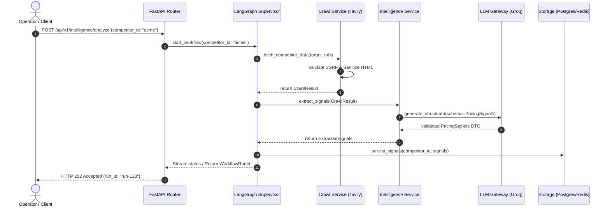

# System Architecture Specification

## 1. Architectural Style: Modular Monolith
The system is constructed as a **Modular Monolith**. All capabilities reside within a unified codebase under `src/`, logically organized into discrete bounded contexts with clear ownership, decoupled data stores, and explicit public interfaces.

---

## 2. Bounded Contexts & Ownership

### 2.1 API Context (`src/api/`)
- **Responsibility**: HTTP routing, request validation, authentication, role-based authorization, SSE streaming for agent progress, RFC 7807 error responses.
- **Dependencies**: Depends on `orchestration`, `intelligence`, `synthesis`. Does not depend on external vendor SDKs directly.

### 2.2 Orchestration Context (`src/orchestration/`)
- **Responsibility**: LangGraph state graph definitions, supervisor routing, workflow state transitions, human-in-the-loop interruption gates, state checkpointing.
- **Dependencies**: Coordinates `crawling`, `intelligence`, `synthesis`, `llm_gateway`, and `storage`.

### 2.3 Crawling Context (`src/crawling/`)
- **Responsibility**: Ingesting raw competitor data from the web. Encapsulates Tavily search queries, raw HTTP retrieval via `httpx`, robots.txt parsing, SSRF URL validation, and HTML sanitization.
- **Dependencies**: Depends on `storage` for caching raw pages. Completely unaware of LLM models or synthesis logic.

### 2.4 Intelligence Context (`src/intelligence/`)
- **Responsibility**: Extracting structured entities (pricing tiers, product capabilities, leadership changes) from sanitized crawl outputs. Comparing extracted signals against historical baselines.
- **Dependencies**: Uses `llm_gateway` for structured inference and `storage` for baseline comparisons.

### 2.5 Synthesis Context (`src/synthesis/`)
- **Responsibility**: Aggregating multi-source competitor signals, evaluating strategic threats, drafting executive briefings, and generating action recommendations.
- **Dependencies**: Uses `llm_gateway` for high-level reasoning and `storage` for historical briefings.

### 2.6 LLM Gateway Context (`src/llm_gateway/`)
- **Responsibility**: Providing a vendor-agnostic interface (`BaseLLMProvider`) for text generation and structured output generation. Implements provider adapters (e.g., `GroqProviderAdapter`, mock adapter), retry policies with exponential backoff, and a dynamic factory.
- **Dependencies**: Standardized on Pydantic and provider SDKs. Isolated from domain logic.

### 2.7 Evaluation Context (`src/evaluation/`)
- **Responsibility**: Offline benchmarking, quality assurance, and regression gating. Contains:
  - `datasets.py`: Curation of gold-standard and synthetic competitor intelligence samples.
  - `evaluators.py`: Algorithmic and model-graded evaluators measuring extraction precision, recall, factuality, and hallucination.
  - `metrics.py`: Aggregate scoring (F1, hallucination penalty, cost and token tracking).
  - `regression.py`: Test runner that executes evaluation suites in CI/CD before deployments.

### 2.8 Storage Context (`src/storage/`)
- **Responsibility**: Database connectivity, migrations, repository abstractions, caching, and state checkpointing.
  - **PostgreSQL**: Stores structured entities, historical competitor snapshots, reports, and audit logs.
  - **Redis**: Stores ephemeral crawl cache, token rate-limiting buckets, and LangGraph workflow checkpoints.

---

## 3. Data Flow & Request Lifecycle

