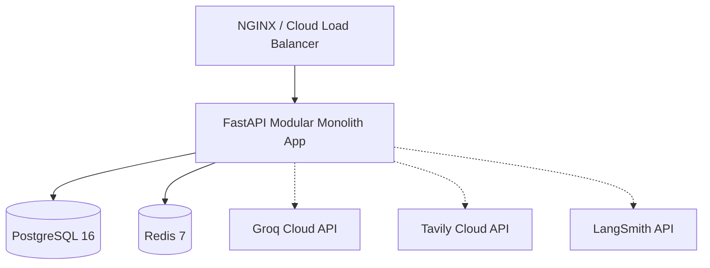

# Operational Guide: Containerization & Deployment

## 1. Deployment Topology
The system is packaged as an optimized Docker container deployed alongside PostgreSQL 16 and Redis 7 via Docker Compose for development/staging, or Kubernetes for production.



---

## 2. Multi-Stage Dockerfile Strategy
The production image utilizes a multi-stage build with UV:
1. **Builder Stage (`python:3.12-slim`)**:
   - Installs UV.
   - Copies `pyproject.toml` and `uv.lock`.
   - Runs `uv sync --frozen --no-install-project --no-dev` into a virtual environment (`/app/.venv`).
2. **Runtime Stage (`python:3.12-slim`)**:
   - Creates a non-root system user (`appuser`).
   - Copies the pre-built virtual environment from builder stage.
   - Copies application source code (`src/`).
   - Sets `PATH="/app/.venv/bin:$PATH"`.
   - Runs the application via `uvicorn src.api.main:app --host 0.0.0.0 --port 8000`.

---

## 3. Environment Configuration
Configuration is injected via environment variables validated at startup by Pydantic Settings:

| Variable | Required | Description |
| :--- | :--- | :--- |
| `ENVIRONMENT` | Yes | `development`, `staging`, `production` |
| `DATABASE_URL` | Yes | Async PostgreSQL connection string (`postgresql+asyncpg://...`) |
| `REDIS_URL` | Yes | Redis connection string (`redis://...`) |
| `GROQ_API_KEY` | Yes | API key for Groq inference |
| `TAVILY_API_KEY` | Yes | API key for Tavily search and crawling |
| `LANGCHAIN_API_KEY`| Yes | API key for LangSmith tracing |
| `LANGCHAIN_TRACING_V2`| Yes | Set to `true` to enable tracing |
| `SECRET_KEY` | Yes | Secret key for JWT verification |

---

## 4. Database Migrations
Database schema changes are managed via Alembic:
```bash
# In CI/CD deployment pipeline before traffic switch:
uv run alembic upgrade head
```
Migrations must be backwards-compatible to permit rolling updates without downtime.
